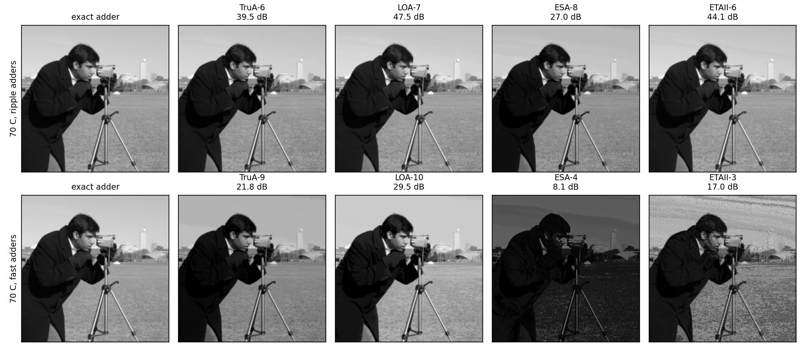
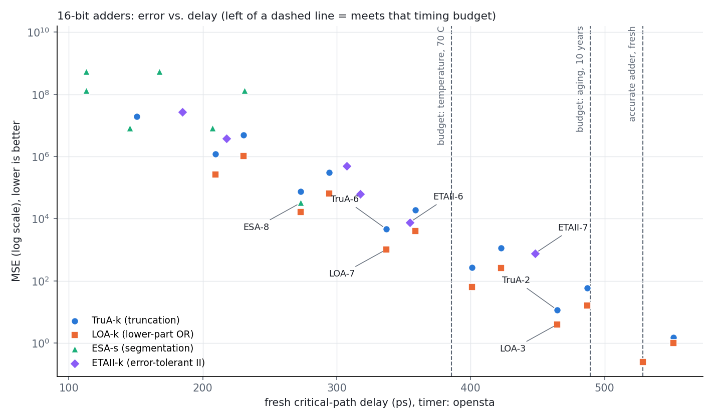
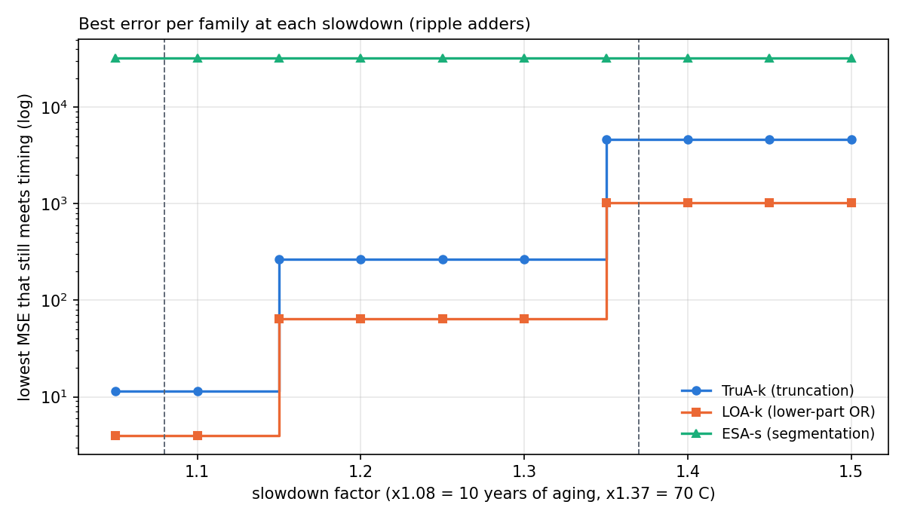
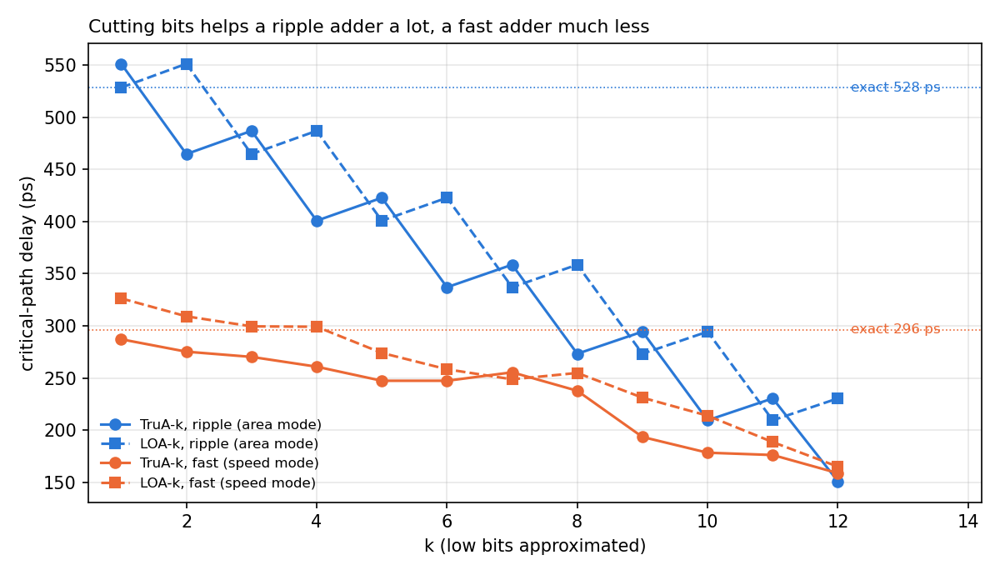
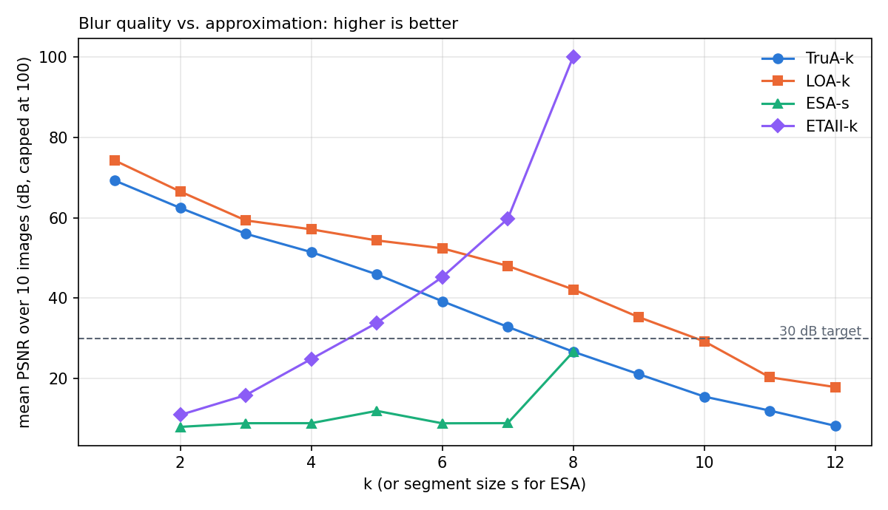

# Is truncation the best way to remove a timing guard-band in a 16-bit adder?

[](https://github.com/njlin664/approx-adder-guardband/actions/workflows/tests.yml)

Aging and heat make transistors slower. The usual fix is a **timing guard-band**: run the clock
slower from day one, just in case. An alternative is to keep the fast clock and make the adder
**approximate**, so its critical path is short enough to survive the slowdown. The simplest way is
to truncate (ignore) the low bits. This project tests whether truncation is actually the best
choice, following the setup of Santiago, Jiang, Amrouch, Gerstlauer, Liu and Han, *Characterizing
Approximate Adders and Multipliers for Mitigating Aging and Temperature Degradations*.

Dean's Research Award project, University of Alberta, supervised by Dr. Jie Han.

**Short answer: no, but how much better the alternative is depends on the case.** At the same
critical-path delay, the lower-part-OR adder (LOA) gives about 3 to 5 times lower mean squared
error than truncation in three of the four cases below. In the fourth (mild aging, fast adders) the
two are about equal and truncation is very slightly better. In the harshest case (fast adders,
70 C) neither design reaches the 30 dB image-quality target, but LOA gets within 0.7 dB of it
(29.3 dB) while truncation falls to 21.1 dB.



## Contents

- [Start here](#start-here)
- [Designs](#designs)
- [Method](#method)
- [Results](#results)
- [Repository map](#repository-map)
- [Reproduce](#reproduce)
- [Limitations](#limitations)
- [Tools and references](#tools-and-references)

## Start here

| If you want to see... | Open |
|---|---|
| The one-page answer with the timing table | [`reports/m2.md`](reports/m2.md) |
| My error metrics next to the paper's tables | [`reports/results.md`](reports/results.md) |
| The adder designs (Verilog) | [`rtl/adders.v`](rtl/adders.v) |
| The golden models (Python) | [`src/golden.py`](src/golden.py) |
| How to re-run everything | [`Makefile`](Makefile) and [Reproduce](#reproduce) |

## Designs

| Design | What it does |
|---|---|
| Exact (ripple-carry) | 16 full adders in a chain, written structurally |
| Carry-lookahead (CLA) | Two-level 4 x 4-bit lookahead adder, exact |
| TruA-k | Ignores the low k bits of both inputs |
| LOA-k | ORs the low k bits; one guessed carry into the exact upper part |
| ESA-s | Independent s-bit segments; carries between segments are dropped |
| ETAII-k | k-bit blocks; each block's carry-in is predicted from the block below only |

## Method

1. **Golden models** in Python ([`src/golden.py`](src/golden.py)), unit-tested ([`src/test_golden.py`](src/test_golden.py)).
2. **Exhaustive error metrics** over all 2^32 input pairs in C with OpenMP
   ([`src/evaluate.c`](src/evaluate.c), [`src/sweep.sh`](src/sweep.sh)): error rate, MED, NMED, MRED, MSE.
   For the TruA, LOA and ESA rows they match the paper's Tables II to V within 0.3% on MSE
   ([`reports/results.md`](reports/results.md)).
3. **RTL** in Verilog ([`rtl/adders.v`](rtl/adders.v)), checked by self-checking SystemVerilog testbenches
   against the golden model: 100,000 vectors x 33 designs with carry-chain coverage
   ([`rtl/tb_adders.sv`](rtl/tb_adders.sv)), 1,065,673 pairs for the CLA ([`rtl/tb_cla.sv`](rtl/tb_cla.sv)), and
   100,000 vectors x 7 ETAII designs ([`rtl/tb_etaii.sv`](rtl/tb_etaii.sv)).
4. **Synthesis** to the open Nangate 45 nm library with Yosys/ABC, and **static timing analysis**
   with OpenSTA ([`src/timing_sweep.py`](src/timing_sweep.py)), in two modes: area-oriented (ripple chains)
   and speed-oriented (parallel-prefix adders, like the paper's "constraint of zero").
5. **Derating**: slowed delay = fresh delay x 1.08 (10 years of aging) or x 1.37 (70 C), factors
   taken from the paper's accurate adder. A design qualifies if its slowed delay is no larger than
   the fresh accurate delay; each family's best design is the qualifying one with the lowest MSE
   ([`src/derate.py`](src/derate.py), [`src/slowdown_sweep.py`](src/slowdown_sweep.py)).
6. **Application**: a 5x5 binomial image blur whose 24 additions per pixel use the approximate
   adder, scored by PSNR on ten standard images ([`src/blur.py`](src/blur.py),
   [`src/psnr_sweep.py`](src/psnr_sweep.py), [`src/app_vs_timing.py`](src/app_vs_timing.py)).

## Results

Fresh accurate adder: 528.5 ps (ripple, area mode), 296.3 ps (fast, speed mode).
Picks come from [`data/picks.csv`](data/picks.csv) (ripple) and [`data/picks_fast.csv`](data/picks_fast.csv) (fast).

| Adders | Slowdown | Truncation pick | LOA pick | MSE ratio (TruA / LOA) | Mean PSNR, TruA / LOA |
|---|---|---|---|---|---|
| Ripple | x1.08 (aging) | TruA-2, MSE 11.5 | LOA-3, MSE 4 | 2.9x | 62.4 / 59.3 dB |
| Ripple | x1.37 (70 C) | TruA-6, MSE 4,652 | LOA-7, MSE 1,024 | 4.5x | 39.3 / 48.0 dB |
| Fast | x1.08 (aging) | TruA-3, MSE 59.5 | LOA-5, MSE 64 | 0.9x (about equal) | 56.0 / 54.3 dB |
| Fast | x1.37 (70 C) | TruA-9, MSE 304,800 | LOA-10, MSE 65,536 | 4.7x | **21.1** / 29.3 dB |

- With fast adders at 70 C the picks (TruA-9 and LOA-10) are exactly the paper's. At 10 years of
  aging they are TruA-3 and LOA-5, against the paper's TruA-5 and LOA-6. Ripple adders need fewer
  bits removed, because their delay falls almost in proportion to the bits cut.
- ESA has a modest error rate but the highest MSE, and fails the 30 dB image target in every case.
- ETAII reproduces the paper's rows (ETAII-6: ER 0.73%, MSE 7.68e3 vs 7.63e3; ETAII-3: ER 18.89%,
  MSE 3.74e6 vs 3.73e6). Its picks have a very low error rate at the ripple budgets but higher MSE
  and more area than LOA's picks.
- A fast exact adder (296 ps) is faster than the TruA and LOA ripple picks for both budgets.
  Relative to a ripple-carry clock it removes the guard-band with no error at all, at about twice
  the area of LOA-7 (1.9x). Once the fast adder sets the clock, the guard-band problem returns,
  and LOA again beats truncation at 70 C.
- Speed-mode picks depend on the synthesis tool version: a different mapping can move a pick by
  one bit (for example LOA-9 versus LOA-10 at 70 C). The error metrics do not change.

### Figures

| | |
|---|---|
| [](figures/delay_vs_mse.png) | [](figures/slowdown_sweep.png) |
| Delay against MSE, ripple adders: [`figures/delay_vs_mse.png`](figures/delay_vs_mse.png) | Best design at every slowdown, ripple: [`figures/slowdown_sweep.png`](figures/slowdown_sweep.png) ([fast version](figures/slowdown_sweep_fast.png)) |
| [](figures/compare_modes.png) | [](figures/psnr_vs_k.png) |
| Ripple against fast delay for every k: [`figures/compare_modes.png`](figures/compare_modes.png) | Image quality against k: [`figures/psnr_vs_k.png`](figures/psnr_vs_k.png) |

Also: [`figures/mse_vs_k.png`](figures/mse_vs_k.png) (MSE against k, Milestone 1) and [`figures/app_70C.png`](figures/app_70C.png)
(the blurred images at the 70 C picks, shown at the top).

## Repository map

```
rtl/        Verilog: adders.v and the testbenches (tb_*.sv)
src/        Python, C and shell: golden models, error metrics, timing, analysis, image app
synth/      the first single-design Yosys and OpenSTA scripts (Milestone 1)
data/       CSV results: error metrics, delays, picks, PSNR
reports/    written results: m2.md and results.md
figures/    every plot and image
Makefile    make test, make all and the other targets (run from this top folder)
```

Run every command from this top folder. The scripts find each other through these folder names,
so if you move a file, update the paths in the [`Makefile`](Makefile) and the
[workflow](.github/workflows/tests.yml) too.

### Designs and golden models

| File | What it is |
|---|---|
| [`rtl/adders.v`](rtl/adders.v) | All the adders in synthesizable Verilog: exact, CLA, TruA, LOA, ESA, ETAII |
| [`src/golden.py`](src/golden.py) | Python reference model of every design; the answer key for everything else |
| [`src/test_golden.py`](src/test_golden.py) | Unit tests for the golden models |

### Error metrics (exhaustive, C)

| File | What it is |
|---|---|
| [`src/evaluate.c`](src/evaluate.c) | Tries all 2^32 input pairs; prints ER, MED, NMED, MRED, MSE |
| [`src/sweep.sh`](src/sweep.sh) | Runs `evaluate` for every design and collects [`data/results.csv`](data/results.csv) |
| [`data/results.csv`](data/results.csv) | The raw error metrics for every design |
| [`reports/results.md`](reports/results.md) | The same numbers next to the paper's Tables II to V |
| [`src/make_report.py`](src/make_report.py) | Builds `results.md` from `results.csv` |
| [`src/plot_mse.py`](src/plot_mse.py) | Draws [`figures/mse_vs_k.png`](figures/mse_vs_k.png) |
| [`src/mred_detective.py`](src/mred_detective.py) | Checks how the input distribution changes the error metrics |

### Hardware verification (Verilog testbenches)

| File | What it is |
|---|---|
| [`rtl/tb_first.v`](rtl/tb_first.v) | First simulation: two input pairs through four adders |
| [`src/gen_vectors.py`](src/gen_vectors.py) | Writes `vectors.mem`: test inputs and the golden model's expected sums |
| [`rtl/tb_adders.sv`](rtl/tb_adders.sv) | Self-checking testbench for 33 adders against the golden model |
| [`src/run_tests.sh`](src/run_tests.sh) | One command: golden tests, vectors, simulation, pass/fail |
| [`rtl/tb_cla.sv`](rtl/tb_cla.sv) | Testbench for the carry-lookahead adder against the simulator's own `+` |
| [`src/gen_etaii_vectors.py`](src/gen_etaii_vectors.py) | Test vectors for the ETAII designs |
| [`rtl/tb_etaii.sv`](rtl/tb_etaii.sv) | Testbench for the ETAII designs |

### Timing (synthesis and static timing)

| File | What it is |
|---|---|
| [`synth/synth.ys`](synth/synth.ys) | Yosys script: one adder to a netlist of 45 nm gates |
| [`synth/sta.tcl`](synth/sta.tcl) | OpenSTA script: slowest path through that netlist |
| [`src/timing_sweep.py`](src/timing_sweep.py) | Synthesizes and times every design; `fast` argument for speed mode |
| [`data/delay.csv`](data/delay.csv) | Delay and area of every design, ripple (area mode) |
| [`data/delay_fast.csv`](data/delay_fast.csv) | Delay and area of every design, fast (speed mode) |

### Analysis

| File | What it is |
|---|---|
| [`src/derate.py`](src/derate.py) | Applies the aging and 70 C slowdowns and picks each family's best design |
| [`data/picks.csv`](data/picks.csv) / [`data/picks_fast.csv`](data/picks_fast.csv) | The picks, ripple and fast |
| [`src/m2_report.py`](src/m2_report.py) | Builds the timing table (`reports/m2_table.md`) and [`figures/delay_vs_mse.png`](figures/delay_vs_mse.png) |
| [`reports/m2.md`](reports/m2.md) | The Milestone 2 summary: timing table, verdict, limitations, and the fast-adder and image-quality checks |
| [`src/slowdown_sweep.py`](src/slowdown_sweep.py) | Repeats the pick for slowdowns from x1.05 to x1.50 |
| [`src/compare_modes.py`](src/compare_modes.py) | Draws ripple against fast delay for every k |

### Image application

| File | What it is |
|---|---|
| [`src/blur.py`](src/blur.py) | 5x5 blur built from the approximate adders, and the PSNR function |
| [`src/psnr_sweep.py`](src/psnr_sweep.py) | PSNR of every design over ten images; writes [`data/psnr.csv`](data/psnr.csv) |
| [`src/app_vs_timing.py`](src/app_vs_timing.py) | Joins image quality with the timing picks; draws [`figures/app_70C.png`](figures/app_70C.png) |

### Project files

| File | What it is |
|---|---|
| [`Makefile`](Makefile) | `make test`, `make all` and the other targets |
| [`.github/workflows/tests.yml`](.github/workflows/tests.yml) | Runs the tests on every push |
| [`.gitignore`](.gitignore) | Generated files that are not stored (netlists, simulation output, the cell library) |
| [`LICENSE`](LICENSE) | MIT license |

## Reproduce

Ubuntu 24.04 (or WSL) with Python 3 (numpy, matplotlib, scikit-image), gcc with OpenMP,
[Icarus Verilog](https://github.com/steveicarus/iverilog), [Yosys](https://github.com/YosysHQ/yosys)
and [OpenSTA](https://github.com/The-OpenROAD-Project/OpenSTA). Put
`NangateOpenCellLibrary_typical.lib` in this top folder; it comes from the
[OpenROAD-flow-scripts](https://github.com/The-OpenROAD-Project/OpenROAD-flow-scripts) repository,
folder `flow/platforms/nangate45/lib/`.

```
make test        # golden-model tests and all RTL regressions (about 2 minutes)
make all         # everything: metrics, timing, analysis, image app (metrics take 20-40 minutes)
```

GitHub Actions runs the golden-model tests, an exhaustive-evaluator check and the RTL regressions
on every push (the badge at the top shows the latest result).

## Limitations

- Uniform derating: one slowdown factor for every gate. The paper used degradation-aware cell
  libraries, where each cell slows differently and the critical path can move.
- The derating factors come from the paper's technology and are applied to a different library.
- Open-source flow (Yosys, ABC, OpenSTA), not Synopsys Design Compiler and PrimeTime. One library,
  one corner, no wire delays, assumed input drive and output load.
- Delay, area and error only; no power analysis. 16-bit adders only.
- Error metrics assume uniformly distributed inputs; the image filter shows how real data differs.
- Speed-mode picks can shift by a bit with the synthesis tool version.

## Tools and references

- Paper: Santiago, Jiang, Amrouch, Gerstlauer, Liu and Han, *Characterizing Approximate Adders and
  Multipliers for Mitigating Aging and Temperature Degradations*.
- [Yosys](https://github.com/YosysHQ/yosys) (synthesis), [OpenSTA](https://github.com/The-OpenROAD-Project/OpenSTA)
  (timing), [Icarus Verilog](https://github.com/steveicarus/iverilog) (simulation),
  [scikit-image](https://scikit-image.org) (test images).
- Nangate 45 nm Open Cell Library, as distributed in
  [OpenROAD-flow-scripts](https://github.com/The-OpenROAD-Project/OpenROAD-flow-scripts).

## License

MIT, see [`LICENSE`](LICENSE).
