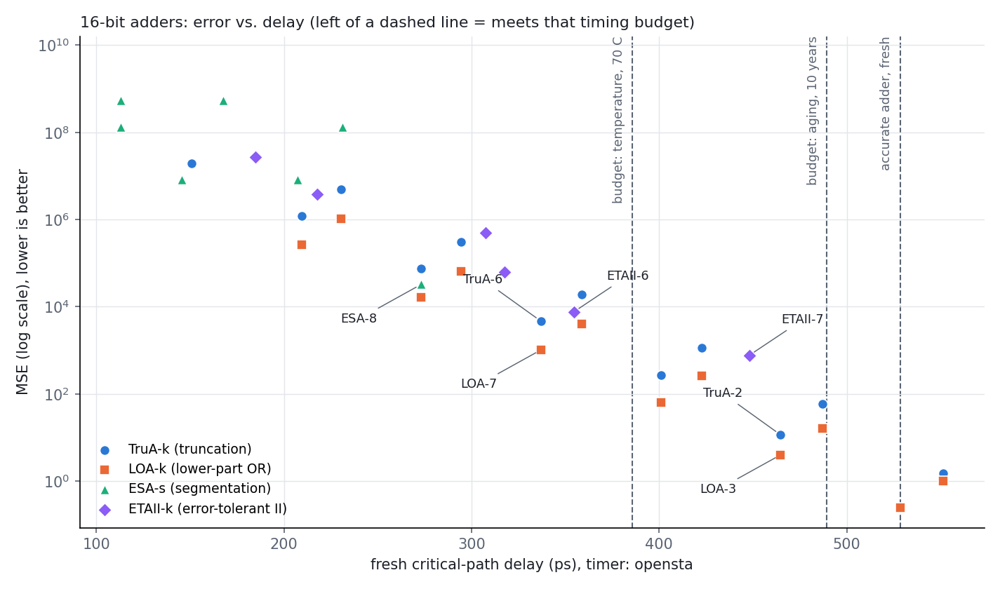

# Milestone M2: is truncation the best way to remove a timing guard-band?

Accurate 16-bit ripple-carry adder, fresh: 528.5 ps (timer: opensta, Nangate 45 nm).

Model: slowed delay = fresh delay x factor. A design meets timing if its slowed delay is at most the fresh accurate delay.

| Scenario | Factor | Budget (ps) | Pick | Fresh (ps) | Slowed (ps) | ER % | MRED | MSE | Area (um^2) |
|---|---|---|---|---|---|---|---|---|---|
| aging, 10 years | 1.08 | 489.4 | TruA-2 | 464.7 | 501.9 | 93.75 | 6.35e-05 | 11.5 | 81.7 |
| aging, 10 years | 1.08 | 489.4 | LOA-3 | 464.7 | 501.9 | 57.81 | 2.91e-05 | 4 | 83.3 |
| aging, 10 years | 1.08 | 489.4 | ESA-8 | 273.2 | 295.1 | 49.80 | 2.68e-03 | 3.264e+04 | 87.2 |
| aging, 10 years | 1.08 | 489.4 | ETAII-7 | 448.0 | 483.8 | 0.29 | 3.16e-05 | 768 | 98.2 |
| temperature, 70 C | 1.37 | 385.8 | TruA-6 | 337.0 | 461.7 | 99.98 | 1.33e-03 | 4652 | 57.2 |
| temperature, 70 C | 1.37 | 385.8 | LOA-7 | 337.0 | 461.7 | 86.65 | 5.04e-04 | 1024 | 63.0 |
| temperature, 70 C | 1.37 | 385.8 | ESA-8 | 273.2 | 374.3 | 49.80 | 2.68e-03 | 3.264e+04 | 87.2 |
| temperature, 70 C | 1.37 | 385.8 | ETAII-6 | 354.6 | 485.8 | 0.73 | 1.58e-04 | 7680 | 98.4 |

## Verdict

(Write two sentences here: is truncation the best choice? Use the numbers above.)

## Limitations

(Uniform derating, open-source tools, one library, ripple-carry baseline, no power. See the guide.)

